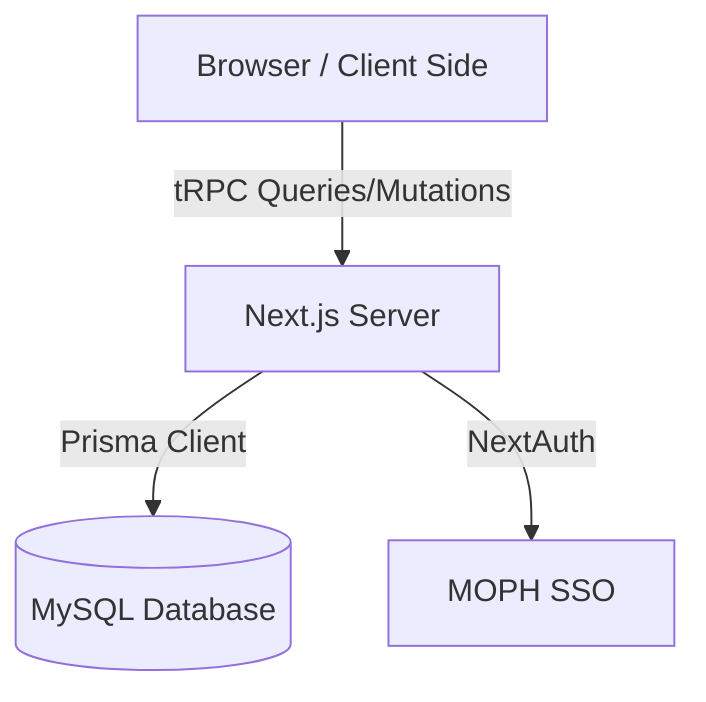

# System Architecture

## 🏗 ภาพรวมสถาปัตยกรรม (High-Level Overview)

ระบบถูกออกแบบมาในรูปแบบ **Monolith** โดยใช้ Next.js เป็นหัวใจหลักในการจัดการทั้ง Frontend และ Backend ผ่าน App Router และ tRPC

## 🛠 ส่วนประกอบหลัก (Core Components)

### 1. Frontend (Client-Side)
- **Framework**: Next.js 16 พร้อมการใช้งาน App Router
- **State Management**: ใช้ tRPC Hooks สำหรับข้อมูลจาก Server และ React State สำหรับ UI Local State
- **UI Library**: shadcn/ui พัฒนาบน Tailwind CSS v4 เพื่อความเร็วและความสวยงาม
- **Client Components**: ใช้ `'use client'` เฉพาะส่วนที่มีการโต้ตอบกับผู้ใช้ (เช่น ฟอร์ม, ปุ่มกด)

### 2. API Layer (tRPC)
- ใช้ **tRPC** เพื่อสร้าง API ที่มีความปลอดภัยด้าน Type (Type-safety) แบบ End-to-end
- **Routers**: แบ่งแยกตามโมดูล (Attendance, Leave/WFH, User, Meeting)
- **Middlewares**: ตรวจสอบสิทธิ์การเข้าถึง (Authentication & Authorization) ก่อนเข้าถึงข้อมูล

### 3. Database Layer (Prisma & MySQL)
- **ORM**: Prisma ช่วยในการจัดการ Schema และการ Query ข้อมูลในรูปแบบ Object
- **Schema**: ออกแบบให้รองรับการเก็บข้อมูลการลงเวลา (Attendance), การลา (Leave Request), และข้อมูลผู้ใช้ (User)

## 🔄 การไหลของข้อมูล (Data Flow)

### การขออนุมัติ WFH
1. ผู้ใช้เลือกวันที่ผ่านหน้า UI (`wfh/new`)
2. ระบบคำนวณวันโดยอัตโนมัติบน Client
3. ส่งข้อมูลผ่าน tRPC Mutation ไปยัง Server
4. Server บันทึกลงฐานข้อมูลผ่าน Prisma และ Invalidate cache ของ Client เพื่อรีเฟรชตารางประวัติ

### การลงเวลาปฏิบัติงาน
1. ผู้ใช้กดปุ่ม เช็คอิน/เช็คเอาท์
2. ระบบตรวจสอบพิกัดหรือสิทธิ์การเข้าถึง
3. บันทึกข้อมูลผ่าน tRPC และอัปเดตสถานะในหน้าหลักทันที

## 🔐 ความปลอดภัย (Security)
- ตรวจสอบสิทธิ์ผ่าน **NextAuth.js** เชื่อมต่อกับ MOPH SSO
- ป้องกันการเข้าถึงหน้าจัดการ Admin ผ่าน **Middleware** (proxy.ts)
- ข้อมูลความลับ (Secrets) ถูกเก็บไว้ใน Environment Variables เท่านั้น
